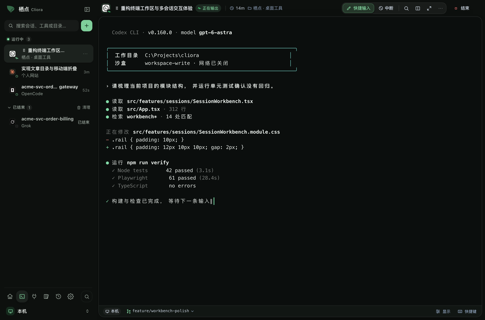
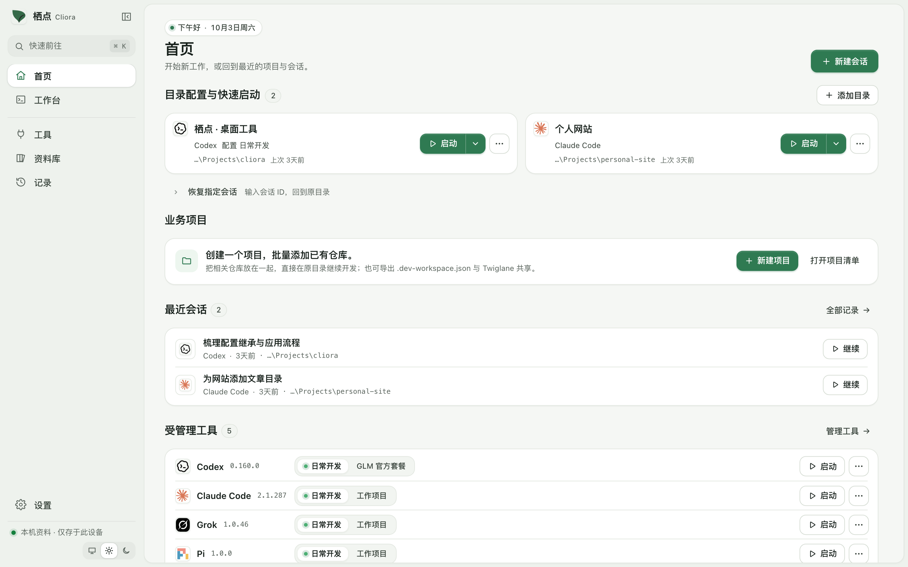

<div align="center">


# Cliora

**One desktop app for all your AI coding CLIs.**

Launch, configure, switch and revisit Codex, Claude Code, OpenCode, Kimi Code and 15 more AI coding command line tools from a single window.

[Download](https://github.com/sakullla/cliora/releases/latest) · [中文](README.md) · [Technical reference](docs/reference.md) · Companion app: [Twiglane](https://github.com/sakullla/Twiglane)



</div>

## Why Cliora

Running several AI CLIs at once usually means one config file per tool, hand-editing JSON/TOML to switch providers, hunting through terminal windows, guessing how much quota is left, and losing last week's conversation. Cliora brings all of that into one local desktop app:

- **One workbench for every session** – a built-in terminal runs multiple CLI sessions side by side, with a session rail, split view, find and quick input. Ended sessions resume in one click.
- **Configuration without hand-editing files** – keep several named profiles (provider, model, key) per CLI. Changes are previewed, backed up before writing, and can be undone.
- **Know your quota and spend** – official subscription quotas plus GLM, Kimi, MiniMax, Sub2API and New API balances; token and estimated cost by tool, model and project.
- **Find any past session** – local CLI histories are indexed for full-text search, favorites and export, and resume in their original directory.
- **All resources in one place** – MCP servers, Skills, Agents, plugins, memories and prompts, maintained once and deployed to several CLIs.

## Screenshots

| Home: projects, recent sessions and managed tools | Records: search and read past sessions |
| --- | --- |
|  |  |


> Screenshots use synthetic mock data; no real accounts, keys or sessions. The UI is shown in Chinese; English is available in Settings.

## Features

**Workbench** – run CLIs inside the app, many at once; choose tool, folder, normal or YOLO mode and an initial prompt, optionally in a fresh Git worktree; find, split, quick input, paste images/files; run CLIs on remote hosts over SSH.

**Profiles and accounts** – named profiles per CLI with shared common settings; model lists fetched from the provider; connectivity checks that do not call billable inference; multiple OAuth accounts (e.g. Codex, OpenCode, Pi) bound to profiles; encrypted backups before every native file write, with external edits detected first.

**Quota and usage** – official and third-party quotas on one card with manual or scheduled refresh; an embedded JavaScript editor for custom relay-site queries (no Node or Python needed); daily trends, cache hit rate and estimated cost.

**Library and resources** – prompts and long-lived rules with project and tag filters; MCP, Skills, Agents, plugins and memories in each CLI's native format.

**Projects and collaboration** – group related repositories into a business project; hand AI changes to [Twiglane](https://github.com/sakullla/Twiglane) for review and commit, with the result reported back; encrypted bundles or WebDAV sync between devices.

**Details** – light, dark and system themes; Chinese and English UI; tray menu for quick launches; in-app updates.

## Supported CLIs

| On by default | Enable in Settings when needed |
| --- | --- |
| Codex · Claude Code · Grok · Pi · OpenCode | oh-my-pi (OMP) · Cursor · Kimi Code · Qoder CN · ZCode · DeepSeek Harness · CodeBuddy · MiMo Code · MiniMax Code · Cline · Devin · Command Code · Antigravity · Kiro |

Capabilities differ per CLI. Unsupported features are hidden rather than substituted; see the [technical reference](docs/reference.md) for the per-tool matrix.

## Install

Download the package for your system from [Releases](https://github.com/sakullla/cliora/releases/latest):

| System | Package |
| --- | --- |
| Windows x64 | `Cliora_x.y.z_x64-setup.exe` |
| macOS (Apple silicon) | `Cliora_x.y.z_aarch64.dmg` |
| Linux x64 | `.AppImage` or `.deb` |

Cliora does not bundle the AI CLIs themselves; install them following each tool's instructions. Cliora detects installed versions and shows install or upgrade commands.

> **macOS:** the app is not notarized by Apple. On first launch, Control-click the app in Finder and choose Open, or run `xattr -dr com.apple.quarantine /Applications/Cliora.app`.

## Privacy

- Everything stays on your machine: profiles, the session index and usage statistics live in a local database. Cliora does not upload session content or usage.
- Secrets go to the system credential store (Windows and Linux) or user-only local files (macOS), never into ordinary profile records.
- Data leaves the device only when you enable WebDAV sync, encrypted, to your own server.

## Build from source

Requires Node.js, Rust 1.90+ and the [Tauri prerequisites](https://v2.tauri.app/start/prerequisites/).

```sh
npm ci
npm run tauri dev
npm run tauri build
npm run verify
cargo test --manifest-path src-tauri/Cargo.toml
```

README screenshots are generated with mock data by `node scripts/capture-readme.mjs` (start `npm run dev -- --port 14736` first). Architecture rules, adapter extension points and platform evidence are in the [technical reference](docs/reference.md) and [AGENTS.md](AGENTS.md); CI and releases are described in [.github/RELEASING.md](.github/RELEASING.md).

## Contributing

Issues and pull requests are welcome. Commits use `feat:` / `fix:` prefixes; include screenshots for UI changes.
