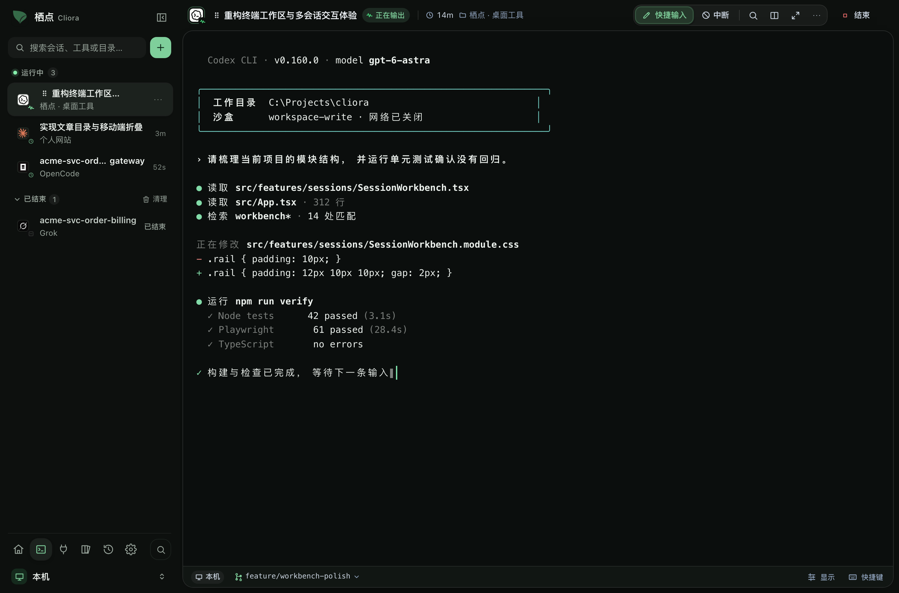
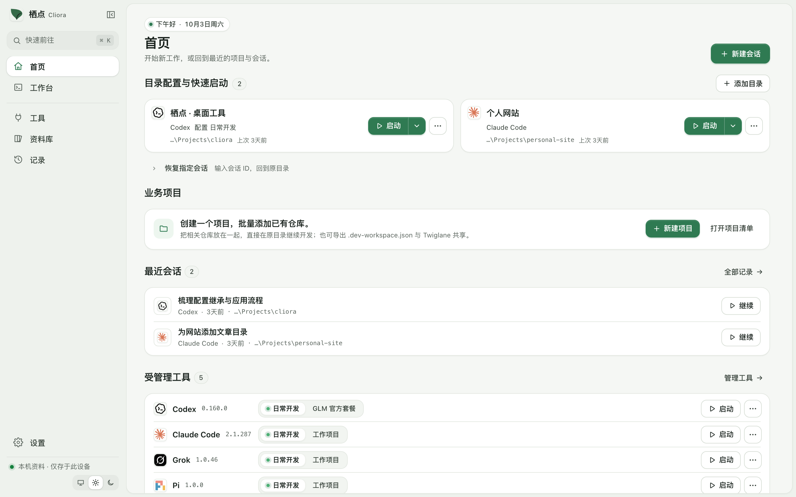
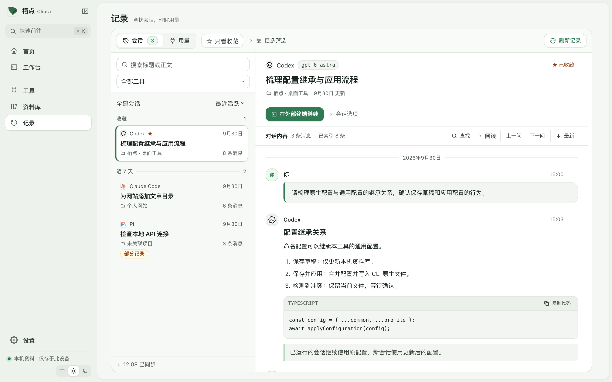

<div align="center">


# 栖点 Cliora

**一个桌面应用，管好你所有的 AI 编程 CLI。**

在同一个窗口里启动、配置、切换和回看 Codex、Claude Code、OpenCode、Kimi Code 等 19 款 AI 编程命令行工具。

[下载最新版](https://github.com/sakullla/cliora/releases/latest) · [English](README.en.md) · [技术参考](docs/reference.md) · 搭档：[Twiglane 枝序](https://github.com/sakullla/Twiglane)



</div>

## 为什么用 Cliora

同时用好几个 AI CLI 时，常见的麻烦有这些：每个工具一套配置文件，换供应商要手改 JSON/TOML，几个终端窗口来回找，额度用到哪儿不知道，上周那段对话也翻不到。Cliora 把这些集中到一个本地桌面应用里：

- **一个工作台跑所有会话**：内置终端，可同时运行多个 CLI 会话，在侧栏切换、分屏、查找、快捷输入；会话结束后还能一键继续。
- **改配置不用手写文件**：为每个 CLI 保存多套命名配置（供应商、模型、密钥），切换前预览改动，写入前自动备份，随时撤回。
- **额度和花费心里有数**：查看官方订阅额度，以及 GLM、Kimi、MiniMax、Sub2API、New API 等供应商余额；按工具、模型、项目统计 Token 与估算费用。
- **历史会话随时找回**：自动索引本机的 CLI 会话记录，支持全文搜索、收藏、导出，并能回到原目录继续对话。
- **资源统一管理**：MCP、Skill、Agents、插件、记忆和提示词集中维护，可分发到多个 CLI。

## 截图

| 首页：常用目录、最近会话与受管理工具 | 记录：搜索和阅读历史会话 |
| --- | --- |
|  |  |


> 截图使用合成的模拟数据，不包含真实账号、密钥或会话。

## 功能一览

### 工作台
- 在应用内直接启动 CLI，多会话并行，侧栏显示运行状态、时长和所在目录
- 新建会话时可选工具、项目目录、普通或 YOLO 模式、初始提示词；可直接在新的 Git 工作树中开始
- 终端支持查找、分屏、快捷输入、粘贴图片/文件；可以连接远程主机，在服务器上运行 CLI

### 配置与账号
- 每个 CLI 保存多套命名配置，常用设置写一次，多套配置共享
- 从供应商接口拉取模型列表，填写地址与密钥即可完成配置；可以先做连通性检查，不会产生调用费用
- 管理多个 OAuth 账号（例如 Codex、OpenCode、Pi），按配置绑定账号
- 每次写入原生配置文件前都会加密备份，检测到外部改动会先停下，让你确认

### 额度与用量
- 官方订阅额度（如 Codex）和第三方套餐余额显示在同一张卡片上，可手动或定时刷新
- 内置 JavaScript 脚本编辑器，不装 Node 或 Python 也能为自建中转站写额度查询
- 用量统计按天显示趋势，并按工具、模型和项目拆分 Token、缓存命中率与估算费用

### 资料库与扩展资源
- 提示词、长期规则统一保存，可按项目和标签筛选，一键带入新会话
- MCP、Skill、Agents、插件、记忆：读取各 CLI 原生格式，启用、停用、导入、分发都在一个界面完成

### 项目与协作
- 业务项目：把多个相关仓库放在一起，从项目里直接启动会话
- 与 [Twiglane](https://github.com/sakullla/Twiglane) 联动：一键把 AI 改动交给 Twiglane 审阅、提交，结果会带回 Cliora
- 加密导出/导入配置包，或通过 WebDAV 在多台设备间同步

### 体验细节
- 浅色、深色和跟随系统三种外观，界面有中文和英文
- 关闭窗口后常驻托盘，可从托盘快速启动常用配置或最近项目
- 应用内自动更新

## 支持的 CLI

| 默认启用 | 可在设置中按需开启 |
| --- | --- |
| Codex · Claude Code · Grok · Pi · OpenCode | oh-my-pi (OMP) · Cursor · Kimi Code · Qoder CN · ZCode · DeepSeek Harness · CodeBuddy · MiMo Code · MiniMax Code · Cline · Devin · Command Code · Antigravity · Kiro |

不同 CLI 支持的能力（账号、额度、MCP、插件等）不完全一样；某项能力不支持时，对应入口会隐藏，不会用其他方式代替。逐项能力对照见[技术参考](docs/reference.md)。

## 安装

前往 [Releases](https://github.com/sakullla/cliora/releases/latest) 下载对应系统的安装包：

| 系统 | 安装包 |
| --- | --- |
| Windows x64 | `Cliora_x.y.z_x64-setup.exe` |
| macOS（Apple 芯片） | `Cliora_x.y.z_aarch64.dmg` |
| Linux x64 | `.AppImage` 或 `.deb` |

Cliora 不附带 AI CLI 本身，请先按各工具的官方说明安装它们。Cliora 会自动检测本机已安装的版本，并给出安装或升级命令。

> **macOS 提示**：应用没有经过 Apple 公证，首次打开时请在“访达”中按住 Control 点按图标，选择“打开”；或者运行 `xattr -dr com.apple.quarantine /Applications/Cliora.app`。

## 隐私

- 所有数据都保存在本机：配置、会话索引和用量统计存于本地数据库；会话内容和用量不会上传给 Cliora。
- 密钥交给系统凭据存储（Windows 和 Linux 上是系统凭据存储，macOS 上是仅当前用户可读的本地文件），不写进普通配置记录。
- 只有你明确选择 WebDAV 同步时，数据才会加密后上传到你自己的服务器。

## 从源码构建

需要 Node.js、Rust 1.90+，以及 [Tauri 的系统依赖](https://v2.tauri.app/start/prerequisites/)。

```sh
npm ci
npm run tauri dev                         # 开发运行
npm run tauri build                       # 打包安装包
npm run verify                            # 前端测试与构建
cargo test --manifest-path src-tauri/Cargo.toml
```

README 截图由 `node scripts/capture-readme.mjs` 用模拟数据生成（需先运行 `npm run dev -- --port 14736`）。架构约定、适配器扩展方式与平台验证记录见 [技术参考](docs/reference.md) 和 [AGENTS.md](AGENTS.md)。

## 参与贡献

欢迎提交 Issue 和 Pull Request。提交信息沿用 `feat:` / `fix:` 前缀；涉及界面的改动请附截图。
