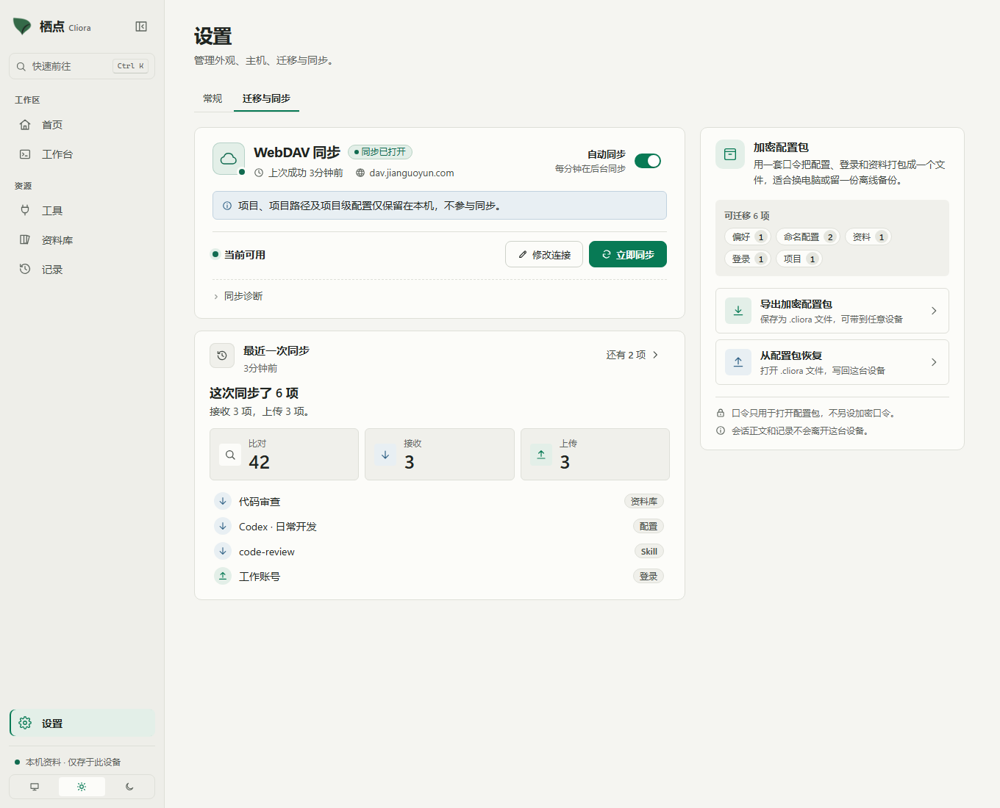
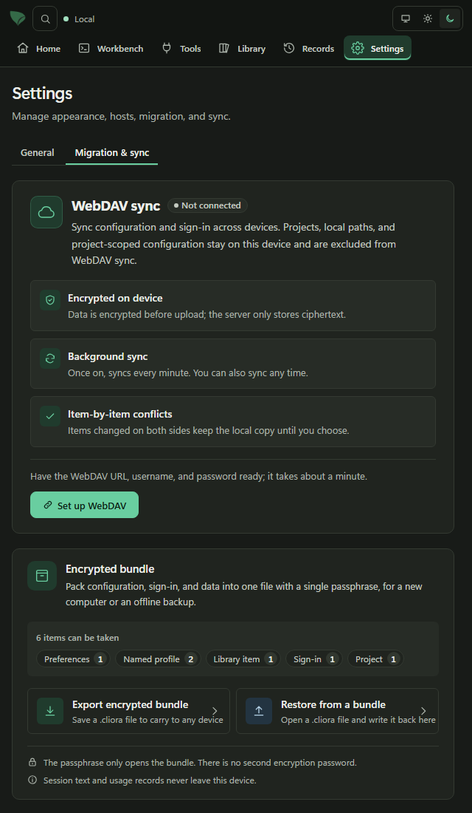

# 0.4.99 修复验证

## 行为与根因

- 工作台离开页面后仍挂载，但没有把页面的 `active` 传入终端可见状态。隐藏终端现在释放 WebGL，停止光标闪烁，同时继续接收 PTY 输出、响应光标位置查询；返回时恢复显示和输入。
- CodeBuddy 的空日志/仅文件快照日志会返回 `EMPTY_SESSION`，恢复逻辑原先因此终止该 CLI 的全部历史扫描。现在只跳过明确的空记录，保留读取错误和会话身份歧义保护。
- 首页发送 `{ "limit": 24 }`，Rust `HistoryFilter.favorite_only` 原先缺少反序列化默认值。现在与前端可选字段契约一致，显式收藏过滤仍生效。
- WebDAV 不再同步项目及项目级配置、MCP/Skill 部署。旧项目版本、删除记录、项目绑定和冲突不再覆盖本机；本机删除不会向旧远端项目发布删除记录。部署 ID 为哈希，使用本机元数据记住排除范围，避免删除后误同步。全局配置、登录和资料继续同步；手动配置包迁移保留项目功能。
- 已经由旧版本导入的项目不自动删除或猜测新路径；可以在本机重新关联目录。
- Windows 完整库测试发现 Git 工作树创建把规范路径 `\\?\C:\…` 作为 Git 参数，Git 拒绝创建 `.git`。创建、删除和失败清理现在复用现有终端路径转换，仅转换外部命令参数，保留规范路径身份和目录检查。相关分支名处理同时修正三项 Clippy 等价写法。
- 工作台菜单已有的 2px/4px 间距改用等值设计变量，通过仓库样式检查。

## 卡顿现场证据及边界

Windows 上原 0.4.95 进程长时间运行时，WebView2 156.0.4314.58 的合成线程持续占用约一个 CPU 核心。原生采样结合匹配 PDB，热点主要为 `cc::FrameSequenceTrackerCollection::DestroyTrackers` 和 `cc::Scheduler::FinishImplFrame`；待移除 tracker 超过百万且继续增长。

该现场证明 WebView2 合成器跟踪对象积压。隐藏终端仍运行的应用缺陷已由浏览器回归复现并修复；尚不能证明它是 WebView2 积压的唯一触发条件，也未完成修复版数十小时原生压力验证。浏览器截图和软件 WebGL 测试不替代这一验证。

## 验证

测试使用合成日志、临时数据库及本机 WebDAV 测试服务器，不改动用户项目、凭据或正在运行的会话。

- TypeScript 类型检查和 Vite 生产构建通过。
- Node 单元及架构/样式检查：160 项通过。
- 非终端 Playwright 套件：661 项通过。
- 终端及真实软件 WebGL 套件单线程重跑：74 项全部通过；最终同步页与偏好同步检查：19 项通过。
- 严格 Rust Clippy `--all-targets -- -D warnings` 通过。
- `capture-sync.mjs --theme all --size 1360,640 --language all`：88 张截图，无页面错误或横向溢出；人工检查已连接与未连接、宽屏与窄屏的同步范围提示。
- Windows Rust 完整库首轮：1231 通过、13 失败、27 忽略。失败包括 9 项工作树路径问题、2 项新测试数据问题和 2 项时限相关断言。修正后单线程复跑工作树、桌面启动、portable 全模块（包括手动迁移和 WebDAV）、会话恢复、首页过滤及两项时限失败：96 项全部通过。未把首轮完整套件记为全通过。

本机共享 Cargo 输出目录中的资源被其他进程占用，Rust 检查使用 `TAURI_CONFIG={"bundle":{"resources":[]}}` 避免 Tauri 重复复制已存在的 ConPTY 资源；仓库的打包配置未改动。
